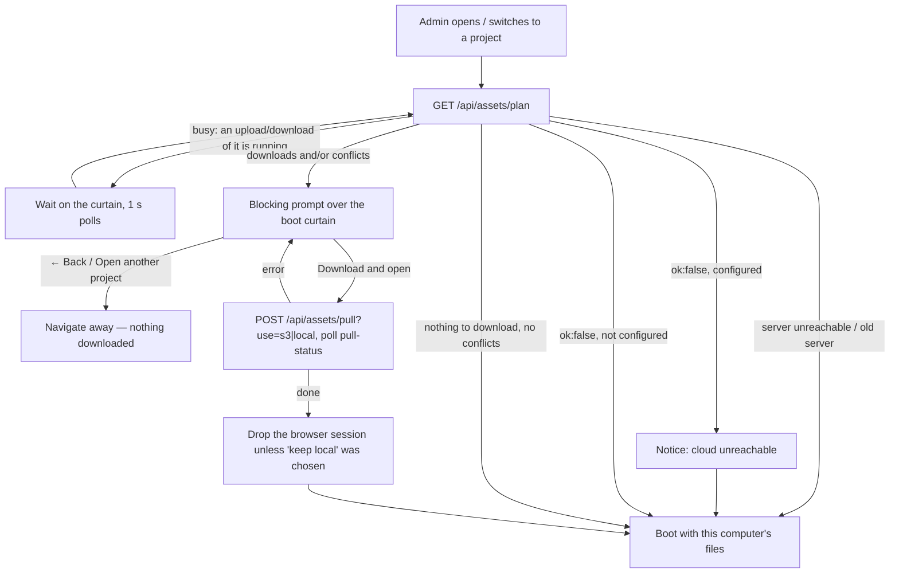

# ADMIN-DATA-SYNC.md — Admin data: cloud ⇄ this computer

> **Living design doc.** Everything about where the ADMIN's project data lives, how it moves
> between S3 and a machine, and the rules that decide it. **Update this file in the same change
> as any edit to** `assets_s3.py`, the `/api/assets/*` routes in `server.py`, `/api/projects`,
> `prepareProjectFiles` / `openProjectFilesDialog` / the upload widget in `app.js`,
> `exportSite`'s `upload` flag, or the admin working session/draft — and add a CHANGELOG entry.
> If this doc and the code disagree, the code is the truth: fix the doc.
>
> Not covered here (separate systems, separate docs): the **published client site**
> (`publish_s3.py`, "☁ Publish to web" in [CLAUDE.md](CLAUDE.md)) and a **visitor's offline copy
> on a phone** ([MOBILE-OFFLINE.md](MOBILE-OFFLINE.md)).

---

## 1. The model

- **S3 is the home of a project's working files.** `s3://<bucket>/ZEROX-PROJECTS-FINAL/<id>/` holds
  every file of `projects/<id>/` — panoramas, plans, renders, videos, brochures and the JSON/SVG/CSV
  the admin edits.
- **`projects/<id>/` is this machine's working copy.** The app always reads and writes the local
  folder; the cloud is reached only at two moments:
  - **Opening a project in the admin** — the local copy is compared with S3 and brought in step,
    after the admin agrees (a blocking download). Nothing to do → nothing is shown.
  - **Pressing Save** (💾 Save, Save as, Publish) — the local save is followed by a queued upload.
    Nothing else ever uploads.
- **When this computer and the cloud disagree about a file this computer changed, the admin
  decides** which copy wins. Nothing is overwritten silently in either direction, and nothing is
  ever deleted from S3.

Agreed with the owner 2026-09-26 (replacing the 2026-09-25 first version — see §14).

---

## 2. Where admin data lives

| Layer | Where | Written by | Notes |
|---|---|---|---|
| **Cloud working folder** | `s3://<bucket>/ZEROX-PROJECTS-FINAL/<id>/<file>` | upload jobs (`_push`) | `Cache-Control: no-cache`. Readable through the bucket's CloudFront domain (the owner chose public over private). |
| **Cloud manifest** | `…/<id>/.b91-assets.json` | `_merge_manifest` | `{project, hash:"md5-lf", updatedAt, files:{rel:{md5,size}}}`. Only ever **merged** (re-read, entries added/updated) — never rewritten from one machine's view. |
| **Local working copy** | `projects/<id>/` | `/api/save`, `/api/upload`, downloads (`_pull`) | What every page (admin and local client) reads. |
| **Local sync record** | `projects/<id>/.b91-sync.json` | `plan`, `_pull`, `_push` | Per file: the content this machine and S3 **last agreed on** (`md5`) + the local `size`/`mtime` at that moment. Stamped with `project`, `prefix`, `hash` — a record from another id or prefix is ignored. **Git-ignored; never synced.** |
| **Browser working session** | IndexedDB `b91-admin` / `session` / `current` | `saveSession` (debounced 600 ms, and after every Save) | ONE slot for all projects, stamped `projectId`. Restored at admin boot when newer than the files. |
| **Browser draft** | localStorage `b91-plot-alignment-draft-v2` | `onAlignmentChanged` | Alignment numbers only, stamped `projectId`. |
| **"Saved here" mark** | localStorage `b91-admin-saved-<id>` | `markSavedHere` after every successful save | Lets the app tell a session that merely mirrors the last Save from one holding unsaved edits. |
| **"Back" target** | sessionStorage `b91-admin-prev-project` | the project switcher | Where the download prompt's **← Back** goes. |
| **Git** | — | — | **Never.** `plot-map/projects/` is git-ignored as a whole (2026-09-27): project data is not source code, and S3 is its only shared home. Older commits still contain project files in history. |

---

## 3. Lifecycle

### 3.1 Opening a project (admin boot)

`init()` → `prepareProjectFiles(BOOT_PROJECT)` runs **before** `loadGeometry`, so nothing is read
from disk until the working copy is settled. Client pages (and bundles) skip it entirely.

The prompt (`openProjectFilesDialog`):
- **Downloads** — "‹id› needs N files (X MB) from the cloud…". No choice needed: these are files
  this computer lacks, or has not touched since the last sync while the cloud copy changed.
- **Conflicts** — listed with why (`changed on this computer` / `changed here and in the cloud` /
  `differs from the cloud copy`), and the admin **must** pick:
  - **Use the cloud copy** → `use=s3`: those files are downloaded over this computer's.
  - **Keep this computer's copy** → `use=local`: they stay; the next Save uploads them.
- **Unsaved edits in this browser** count as a conflict when anything will be downloaded
  (`unsavedBrowserEdits`: the session or draft for this project is more than 2 s newer than the
  "saved here" mark). Reason: the boot's session restore picks the newest by `savedAt`, so a
  download under unsaved browser edits would be silently undone right after.
- After a successful download the browser session and draft for this project are **dropped**
  (`discardBrowserWork`) unless the admin chose to keep local — the disk is now the truth.
- Leaving: **← Back to ‹prev›** (when the switcher recorded where you came from) or an
  **Open another project…** list (local + cloud-only projects).

### 3.2 Editing

- Most edits go to the **browser session** (IndexedDB, 600 ms debounce) and, for alignment, the
  draft. Nothing reaches disk until a save.
- **Landmark and amenity edits auto-save to disk** ~400 ms after each change (`onLandmarksChanged`
  / `onAmenitiesChanged` → `exportSite()` with no `upload`). They stay **local** — they reach the
  cloud with the next Save.

### 3.3 Saving

💾 Save (`headerSave`), ⋯ → Duplicate as… (`commitProjName`, the `saveas` action) and Publish
(`publishNow`) call **`exportSite({ upload: true })`**:

1. `serverSave` — small files as JSON to `POST /api/save`, then files > 5 MB as raw bodies to
   `POST /api/upload`. (This order is why `/api/save` must NOT start an upload itself: the big
   files arrive after it.)
2. `saveSession(true)` + `markSavedHere(BOOT_PROJECT)`.
3. `queueUpload(state.projectId)` → `POST /api/assets/push` → a job in the project's queue, shown
   in the **upload widget**.

### 3.4 Upload queue and widget

- **One job per Save**, queued per project; a project's jobs run **one after another** (one
  transfer lock per project), different projects in parallel. A Save made while a big upload runs
  is simply the next job — never lost.
- Each job decides **when it starts** what to send (§4), so a later job sends whatever changed
  after the earlier one scanned.
- Jobs run in the **server** (threads in `server.py`): they survive a page reload, a project
  switch, closing the tab. They do **not** survive stopping `server.py` (see §12).
- Widget (`renderUploadDock`, bottom-right): *Waiting for the upload before it…* → *Checking what
  changed…* → *N of M files · X of Y MB* + bar + current file → *✓ Uploaded N files* /
  *✓ Already up to date* (12 s, only for jobs this page watched run) or *Upload failed: …* with
  **Retry** (shown until dismissed or replaced by a later job of the same project). `keptNewer`
  adds "N files are newer in the cloud — reopen the project to get them". Polls
  `/api/assets/jobs` every 1 s while anything is active; picked up again at boot
  (`initProjectBar` → `pollUploads`).

### 3.5 No cloud

- **Not configured** (no/invalid `publish.config.json`): every `/api/assets/*` answers
  `{ok:false, configured:false}` → boot opens normally; Save shows one notice per page ("saves
  stay on this computer").
- **Unreachable** (no network, bad AWS login): the plan fails → notice "working with the files on
  this computer" → boot opens normally; a Save's job fails in the widget with **Retry**.
- The S3 client gives up quickly: `connect_timeout=4`, `read_timeout=60`, 2 attempts.

---

## 4. The decision rules

Per file, with **L** = local md5, **R** = the sync record's md5 (last agreed), **S** = the S3
manifest's md5 (text files hashed with CRLF→LF, §5):

| Situation | `plan()` reports | open, `use=s3` | open, `use=local` | Save (`_push`) |
|---|---|---|---|---|
| in S3 only | download · `missing` | downloaded | downloaded | — |
| local only | `localOnly` (count) | — | — | **uploaded** |
| L = S | in sync (record refreshed) | — | — | — |
| L = R, S ≠ R | download · `updated` | downloaded | downloaded | **not uploaded** (`keptNewer`) |
| L ≠ R, S = R | conflict · `local` | overwritten | kept | uploaded |
| L ≠ R, S ≠ R | conflict · `both` | overwritten | kept | uploaded |
| no R, L ≠ S | conflict · `unknown` | overwritten | kept | uploaded |

The one-line version: **a file only moves toward the side that hasn't changed it; when both sides
might have, the admin chooses at open, and Save means "this computer's edits win".**

---

## 5. Invariants — don't break these

1. **Nothing is ever deleted from S3** by this code, and the manifest is only ever **merged**
   (re-read immediately before each write). A machine missing a file must never make it vanish
   for the others. Cleanup of S3 is a manual act.
2. **Only an explicit Save uploads** (`exportSite({upload:true})`). Auto-saves, `/api/save`,
   `/api/upload` and downloads never do.
3. **Downloads happen only after the admin agrees** in the prompt. The server never fetches from
   S3 on a request for a missing file — a missing file is an instant 404.
4. **A Save never uploads a file this computer hasn't changed** when S3 holds something else — that
   is someone else's newer work.
5. **Opening never overwrites a file this computer changed** unless the admin picks the cloud copy.
6. **One transfer at a time per project** (download or upload); `plan` answers `{busy:true}` while
   one runs, `start_pull` refuses.
7. **Text files hash with CRLF folded to LF** (`TEXT_EXTS`): git's autocrlf rewrites line endings
   on checkout and that must not read as an edit. Both sides must use the same rule — S3 manifests
   say which (`hash:"md5-lf"`); older raw-md5 manifests are upgraded file by file in `plan`.
8. **Anything that is never uploaded must never be expected** — hence the exclusions in §6 apply to
   both directions.
9. **Project data never goes into git** — `plot-map/projects/` is ignored; don't force-add into it.

---

## 6. What never syncs

Decided by `is_synced_path` / `_local_files` in `assets_s3.py`:
- any path inside the project folder with a part starting with **`.`** — `.b91-sync.json`,
  generated `.pwa-icon-*.png`, `.backup-renumber-*` folders the renumber tool leaves, `.originals`;
- **`_originals/`** — pre-compression masters, kept only so a local compression can be undone;
- **`*.part`, `*.tmp`** (half-written files) and OS junk (`thumbs.db`, `desktop.ini`).

---

## 7. Download details (`start_pull` → `_pull`)

- Re-plans inside the job, so it acts on the state at start. `use=s3` adds the conflicts.
- **Media first, text (JSON/SVG/CSV) last** — if it stops half-way, no data file names a picture
  that hasn't arrived.
- Each file: `download_file` → `<file>.part` → md5 → `os.replace` → sync record updated → next.
  A failure removes the `.part` and stops the job; files already downloaded stay, and **Try
  again** re-plans and fetches the rest.
- If a downloaded object's md5/size differs from the manifest (the manifest was behind), the
  manifest entry is corrected afterwards.
- Progress (bytes via boto3 callback) at `GET /api/assets/pull-status`, polled every 400 ms by the
  prompt, which also drives the boot curtain's bar (`showBootBar`).
- Everything in the S3 folder comes down, including files nothing references any more (old tour
  images, say): the cloud folder IS the working folder.

## 8. Upload details (`enqueue_push` → `_push_worker` → `_push`)

- `enqueue_push` checks the config first (a missing config is an immediate error, not a failed
  job), creates the job and starts the project's worker if none runs.
- The worker takes the oldest `queued` job, takes the project's transfer lock, marks it
  `uploading`, runs `_push`, marks `done`/`error`.
- `_push` lists local files, applies §4, uploads with `ContentType` from
  `deploy_s3.content_type_for` and `Cache-Control: no-cache`, byte progress via callback.
- After each file: sync record updated. The manifest is merged after every file ≥ 8 MB
  (`BIG_FILE`) and at the end, so an interrupted job never re-sends a finished video.
- A file **rewritten while it was uploading** (checked by size+mtime) is recorded in the manifest
  as unknown (`md5:""`), so the job queued by that later save sends it again.
- History: the last 40 jobs (`JOB_HISTORY`), newest first from `jobs()`. `retry(id)` queues a new
  job for the same project.

---

## 9. HTTP API (`server.py`)

| Route | Answer |
|---|---|
| `GET /api/assets/plan?project=` | `{ok, busy}` or `{ok, busy:false, download:[{path,size,reason}], conflicts:[{path,localSize,s3Size,kind}], inSync, localOnly, bytes, conflictBytes}` |
| `POST /api/assets/pull?project=&use=s3\|local` | `{ok, started}` · `{ok:false, busy:true, error}` |
| `GET /api/assets/pull-status?project=` | `{ok, job:{state:running\|done\|error, use, filesTotal, filesDone, bytesTotal, bytesDone, current, error, startedAt, endedAt}}` |
| `POST /api/assets/push?project=&label=` | `{ok, job}` — the queued job |
| `GET /api/assets/jobs` | `{ok, jobs:[{id, project, label, state:queued\|uploading\|done\|error, createdAt, startedAt, endedAt, filesTotal, filesDone, bytesTotal, bytesDone, current, uploaded, keptNewer, error}]}` newest first |
| `POST /api/assets/retry?id=` | `{ok, job}` |
| `GET /api/projects` | `{projects:[local ids], cloud:[ids only in S3]}` (cloud list cached 60 s) |

Any `/api/assets/*` failure: `{ok:false, configured:<bool>, error}` with HTTP 200 (so the page can
read it). Times are the **server's** clock (seconds).

---

## 10. Code map

**`assets_s3.py`** — paths: `project_prefix`, `is_synced_path`, `_local_path`, `_local_files` ·
hashing: `_is_text`, `_md5_of`, `_md5_bytes`, `_stat_md5` (cached by size+mtime, or taken from the
record) · record: `_load_record`, `_save_record`, `_agreed` · S3: `_clients` (timeouts), `_connect`,
`_load_manifest`, `_merge_manifest`, `_s3_text_md5` · coordination: `_transfer_lock`,
`_record_lock`, `busy` · `plan` · downloads: `start_pull`, `_pull`, `pull_status` · uploads:
`enqueue_push`, `_push_worker`, `_push`, `jobs`, `retry` · `cloud_projects` · CLI `_cli`.

**`server.py`** — `do_assets_get` / `do_assets_post` / `_assets_call` (the routes above);
`/api/projects` adds `cloud`; `_serve_static` returns a plain 404 for a missing file; `/api/save`
does not upload.

**`app.js`** — section "Project working files: the cloud copy ⇄ this computer" (just after the
boot progress bar): `prepareProjectFiles`, `openProjectFilesDialog`, `waitForProjectTransfer`,
`showBootBar`, `unsavedBrowserEdits`, `markSavedHere`, `discardBrowserWork`, `assetsApi`,
`PF_KIND`; "Cloud uploads widget": `queueUpload`, `pollUploads`, `renderUploadDock`,
`uploadShown`. Elsewhere: `exportSite({upload})`, `headerSave`, `commitProjName` (saveas),
`publishNow`, `initProjectBar` (cloud-only projects in an `<optgroup>`, remembers the previous
project, starts `pollUploads`).

**`styles.css`** — `.pf-dlg-*` (the prompt; `z-index` above the boot curtain's 999999),
`.upload-dock` / `.ud-*` (the widget, bottom-right, left of the zoom column).

**`.gitignore`** — `plot-map/projects/` as a whole (which also covers `.b91-sync.json` and `*.part`).

---

## 11. Configuration

- `publish.config.json` (git-ignored; template `publish.config.example.json`), **shared with ☁
  Publish and read through the same `publish_s3.load_config`** — so sync needs everything Publish
  needs: `bucket`, `region`, `distributionId`, `publicBaseUrl` and a `password` (unused by sync),
  plus optional `awsProfile`. A config that fails that check makes sync report
  `configured:true` with the error. AWS credentials come from the machine's AWS profile and never
  reach a browser.
- Prefix: `BASE_PREFIX = "ZEROX-PROJECTS-FINAL/"`.
- First-time upload of existing projects: `python assets_s3.py --all` or
  `python assets_s3.py <id> …` (same rules as a Save).

---

## 12. Edge cases & known limits

- **Google Earth projects** ([GoogleEarthView.md](GoogleEarthView.md)) add no files to sync. The
  background is a block of settings in `alignment.json`, and the imagery is never saved (Google's
  terms). That block includes the project's own **Google key**, so the key travels wherever
  `alignment.json` does: the private S3 working copy and every admin machine that opens the
  project. That is fine for a browser key, which visitors see anyway, but it's why a client
  must be given a dedicated, website-restricted key and never a server one.

- **Two machines edit the same file**: whichever saves last wins in S3; the other sees `both` at
  its next open (or a plain `updated` download if it hadn't touched the file).
- **Two machines update the manifest at the same moment**: the read-then-write window is small,
  and a lost entry heals itself — the next open sees the object differ from the manifest, downloads
  it, and corrects the entry.
- **`server.py` stopped mid-upload**: the job is gone (jobs live in memory). The files it didn't
  finish are still "changed on this computer", so the next open lists them as conflicts
  (`local`) — keep this computer's copy and Save.
- **Renamed or duplicated project**: the sync record names the old id, so it's ignored; the new id
  has no cloud folder until its first Save. The old cloud folder stays (never deleted) and shows
  in the switcher as cloud-only.
- **Deleted project** (moved to `projects/.trash/`): its cloud folder stays and shows as
  cloud-only; opening it downloads it again.
- **A fresh clone has no projects at all** (they aren't in git): the client shows an empty project
  until the admin opens it — with `publish.config.json` and an AWS login on that machine, the
  admin's download prompt fills `projects/<id>/` from S3. Without cloud access there is nothing to
  open.
- **Pulling the commit that stopped tracking projects** (2026-09-27) deletes the previously
  tracked project files from that clone's working copy (git removes files a commit deletes). Every
  one of them was in S3 with identical content at that point, so the next admin open downloads
  them back; files that were never tracked (images, videos) are untouched.
- **The browser session is one slot**: only the project last edited in this browser can have
  unsaved browser edits.
- **Old/unreferenced files** in a cloud folder are downloaded like everything else; pruning is
  manual.
- **Admin on another device on the LAN**: widget times are the server's clock.
- **Not yet tried on a second real machine**, nor a download cut off by a real network drop.

---

## 13. Verifying a change

1. **Rules, offline:** `python tests/test_assets_s3.py` (from `plot-map/`) — runs `assets_s3`
   against a fake S3 in a temp folder, no network, no AWS. Covers: dot-files and `_originals`
   never upload; in-step → nothing to do; CRLF-only ≠ edit; `local`/`both`/`unknown` conflicts;
   `use=local` keeps and the next Save uploads only that file; a newer S3 copy is downloaded and
   never overwritten by an untouched local one (`keptNewer`); two quick Saves queue and both land;
   a local deletion never drops a manifest entry. **Add a case here for any new rule.**
2. **In the browser** (`preview_start plot-map`, admin URLs):
   - an in-step project opens with **no prompt**;
   - change a project JSON on disk → reopen → the conflict prompt; both choices;
   - a project with missing files (or a cloud-only one from the switcher) → download progress →
     opens, and a reopen shows no prompt;
   - 💾 Save → widget shows the job to "✓ Uploaded…"; two Saves in a row → the second waits;
   - **← Back** from the prompt downloads nothing;
   - a missing optional file (e.g. `projects/<id>/loading.web.jpg`) 404s instantly.
3. `python -m py_compile server.py assets_s3.py` and `node --check app.js`.

Caution: real checks against the bucket write to the user's working folders in S3 (uploads are
never deleted). Test uploads on a scratch project (e.g. `try1`), never on a live one.

---

## 14. History

- **2026-09-25 — first version** (another developer): Save mirrored the project to S3 in the
  background; admin boot pulled missing files; the server fetched any missing project file from S3
  on demand. Problems found on review: a pull replaced every local file whose *size* differed from
  S3 (unsaved local work lost to older cloud copies); every missing optional file waited 0.5–1.6 s
  on S3; a Save during a running upload was skipped, and `/api/save` started the upload before the
  Save's big files arrived; dot-files were uploaded but could never be downloaded.
- **2026-09-27 — projects out of git**: `plot-map/projects/` ignored as a whole and its 127 tracked
  files (609 MB) removed from the index — S3 is the only shared home. Checked first: every one of
  them was in S3 with identical content (line endings aside), except a `Backup` folder (not a valid
  project id, so never synced) and eleganzav2's `.backup-renumber-*` folders (dot-folders never
  sync); those now exist only on the machine that has them, and in git history.
- **2026-09-26 — rework to the owner's plan** (this design): prompt-first blocking downloads,
  conflict choice, per-Save upload queue + widget, no on-demand fetch, sync record, CRLF-neutral
  hashing, cloud-only projects in the switcher. Details in [CHANGELOG.md](CHANGELOG.md).
